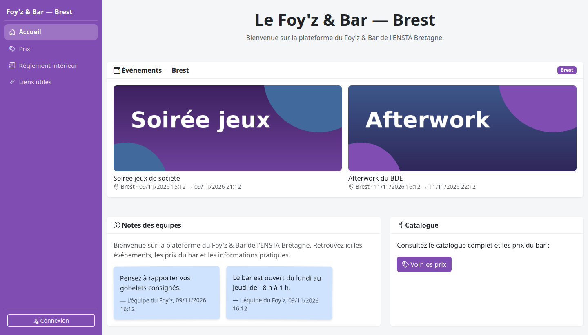

# Plateforme Foy'z & Bar — Brest

[](https://github.com/pauldebise/plateforme_foyz_bar/actions/workflows/ci.yml)
[](LICENSE)
[](https://www.python.org/)
[](https://docs.docker.com/compose/)
[](https://www.postgresql.org/)

Plateforme web de gestion du Foy'z/Bar de l'ENSTA Bretagne : interface publique,
interface équipe (caisse, comptes étudiants, statistiques, trésorerie) et
interface administrateur.

Le campus de Paris est **archivé** : ses données historiques restent en base et
restent libellables, mais le campus n'est ni exposé ni modifiable. Les campus
actifs sont pilotés par `FOYZ_ACTIVE_CAMPUSES` (voir
[DEPLOIEMENT.md](docs/DEPLOIEMENT.md#variables-denvironnement)).

**Instance en production** : [foyz.fr](https://foyz.fr)



*Interface publique — données de démonstration.*

## Fonctionnalités

- **Caisse** : encaissement, rechargements, retraits, transferts, consignes,
  annulations et tarif équipe.
- **Comptes étudiants** : un portefeuille par campus, blacklist alcool,
  historique et recherche.
- **Statistiques et trésorerie** : ventes, articles, étudiants, 12 mois
  glissants, exports CSV.
- **Événements** : passerelle d'encaissement par lien temporaire, sans compte.
- **Administration** : comptes, catalogue, fûts et tireuses, journal d'audit,
  tableau de bord santé.
- **API externe** : lecture des consommations et des prix, jetons à portée
  limitée ([API.md](docs/API.md)).
- **PWA installable** : pas de vente mise en file hors ligne, l'encaissement
  exige le réseau.
- **Sécurité** : CSRF, scrypt, anti-bruteforce, journal d'audit, en-têtes
  stricts.

## Stack

- **Backend** : Python 3.12 / Flask 3, architecture modulaire en blueprints.
- **Base de données** : SQLAlchemy 2 — SQLite en développement, PostgreSQL 16 en
  production, schéma versionné par Alembic.
- **Front-end** : Bootstrap 5, Chart.js et polices auto-hébergés, templates
  Jinja2, JavaScript vanilla. Aucune dépendance CDN.
- **Exécution** : Docker Compose (recommandé) ou Gunicorn + Nginx.
- **CI** : GitHub Actions — ruff, pip-audit, tests SQLite et PostgreSQL, build
  Docker.

## Démarrage rapide

```bash
python3 -m venv .venv
source .venv/bin/activate
pip install -r requirements.txt
cp .env.example .env            # renseigner ADMIN_PASSWORD
flask --app wsgi.py init-db     # tables + compte administrateur
python run.py                   # http://127.0.0.1:5000
```

> `psycopg2-binary` n'est requis que pour la production PostgreSQL ; il est
> inutile en local avec SQLite.
>
> En production, l'application **refuse de démarrer** si `SECRET_KEY` est absente
> ou fait moins de 32 caractères, ou si `ADMIN_PASSWORD` est absente ou triviale
> (« admin »). En développement, ces valeurs sont tolérées mais signalées dans
> les logs.

## Configuration

| Variable | Rôle | Défaut |
|---|---|---|
| `FLASK_ENV` | `production` ou `development` | `production` |
| `SECRET_KEY` | Signature des sessions — **obligatoire en production** (32 caractères minimum) | valeur de dev, refusée en production |
| `DATABASE_URL` | URI SQLAlchemy (SQLite ou PostgreSQL) | SQLite locale |
| `ADMIN_PASSWORD` | Mot de passe administrateur initial — **obligatoire en production** | `admin`, refusé en production |
| `FOYZ_ACTIVE_CAMPUSES` | Campus exposés, séparés par des virgules. Production : `brest` | `brest,paris` |

La liste complète et les options de déploiement sont dans
[DEPLOIEMENT.md](docs/DEPLOIEMENT.md#variables-denvironnement).

## Sécurité

- Mots de passe hachés (`werkzeug`, scrypt par défaut), identifiants jamais en
  clair.
- Protection CSRF sur les formulaires ; l'API externe utilise un jeton porteur,
  jamais un cookie.
- Anti-bruteforce partagé entre les workers, sans verrouillage définitif.
- Mot de passe administrateur séparé pour le découvert, les annulations et la
  blacklist ; échecs et succès journalisés.
- Jetons d'API stockés en SHA-256, limités à un campus et à une fenêtre de
  lecture.
- En-têtes stricts, uploads restreints, SVG refusé, journaux JSON, jetons de
  passerelle masqués.

Le modèle complet est décrit dans
[ARCHITECTURE.md](docs/ARCHITECTURE.md#sécurité).

## Documentation

| Document | Contenu |
|---|---|
| [ARCHITECTURE.md](docs/ARCHITECTURE.md) | Composants, données, sécurité, règles structurantes |
| [DEPLOIEMENT.md](docs/DEPLOIEMENT.md) | Docker, systemd/Nginx, Cloudflare, variables, Alembic |
| [EXPLOITATION.md](docs/EXPLOITATION.md) | Sauvegardes, supervision, rétention, performance, tests |
| [MIGRATION.md](docs/MIGRATION.md) | Bascule des anciennes bases Brest/Paris |
| [FONCTIONNALITES.md](docs/FONCTIONNALITES.md) | Identifiants, PWA, décor de Noël, statistiques |
| [API.md](docs/API.md) | API externe `/api/v1` |
| [CONFIDENTIALITE.md](docs/CONFIDENTIALITE.md) | Politique de confidentialité (à adapter) |
| [THIRD_PARTY_NOTICES.md](THIRD_PARTY_NOTICES.md) | Licences des dépendances front |

## Licence

Le code source de ce dépôt est distribué sous **licence MIT** — voir
[`LICENSE`](LICENSE).

La licence couvre uniquement le code source. Le nom « Foy'z & Bar », le logo,
les icônes de l'application et les documents (`docs/`) restent hors périmètre.
Les bibliothèques tierces embarquées dans `app/static/vendor/` conservent leurs
licences respectives (MIT) ; le détail figure dans
[`THIRD_PARTY_NOTICES.md`](THIRD_PARTY_NOTICES.md).
