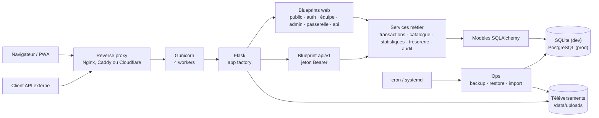

# Architecture — Plateforme Foy'z & Bar

Vue d'ensemble des composants, des flux et des règles structurantes de la
plateforme. Ce document reste volontairement au niveau global : l'installation
et le déploiement sont décrits dans [DEPLOIEMENT.md](DEPLOIEMENT.md),
l'exploitation dans [EXPLOITATION.md](EXPLOITATION.md), la migration dans
[MIGRATION.md](MIGRATION.md), l'API externe dans [API.md](API.md) et la
politique de confidentialité dans [CONFIDENTIALITE.md](CONFIDENTIALITE.md).

## Vue d'ensemble

Le navigateur et les clients de l'API passent par le même reverse proxy.
Gunicorn sert l'application Flask, organisée en blueprints (routes HTTP) et
services (logique métier). SQLAlchemy est l'unique accès à la base. Les
téléversements et les sauvegardes sont sur des volumes ou répertoires séparés.

## Composants

### Application Flask

- `wsgi.py` est le point d'entrée de production ; `run.py` lance le serveur de
  développement.
- `app/__init__.py` crée l'application, charge la configuration, enregistre les
  blueprints, applique le contrôle CSRF et les en-têtes de sécurité.
- `app/config.py` lit les variables d'environnement ; `app/campus.py` définit
  les campus connus et actifs ; `app/extensions.py` instancie SQLAlchemy.
- `app/schema.py` applique le schéma : `create_all()` en SQLite de
  développement, révisions Alembic en PostgreSQL de production.
- `app/logging_setup.py` produit des journaux JSON ; `app/gunicorn_logging.py`
  masque les jetons de passerelle dans le journal d'accès.

### Blueprints

| Blueprint | Préfixe | Rôle |
|---|---|---|
| `public` | `/` | Accueil, catalogue, règlement, liens utiles |
| `auth` | — | Connexion et déconnexion |
| `team` | `/equipe` | Caisse, comptes étudiants, historique, statistiques, trésorerie, notes |
| `admin` | `/admin` | Comptes, équipe, articles, fûts et tireuses, événements, journal, santé, jetons API, module développement |
| `gateway` | `/passerelle/<token>` | Encaissement d'un événement sans compte, via un lien à jeton |
| `api` | `/api` | Endpoints JSON internes à la caisse et à la passerelle |
| `api_v1` | `/api/v1` | API externe : catalogue, consommations, prix ; jeton Bearer |

### Services métier

Les routes restent minces ; les règles métier sont dans `app/services/` :

- `transactions.py` : ventes, rechargements, retraits, transferts, retours de
  consignes et annulations ; verrouillage des portefeuilles et idempotence.
- `catalog.py` : articles, fûts, tireuses et prix.
- `stats.py`, `treasury.py`, `event_recap.py` : agrégats, exports CSV et
  récapitulatifs d'événements.
- `audit.py`, `adminpw.py`, `passwords.py`, `loginthrottle.py`,
  `api_tokens.py` : journal d'audit, mot de passe administrateur, politique de
  mot de passe, limitation des connexions et jetons d'API.
- `health.py` : sonde `/health` et tableau de bord de santé.
- `settings.py` : réglages modifiables depuis l'administration.

## Données

Les modèles SQLAlchemy sont dans `app/models/` :

| Domaine | Modèles |
|---|---|
| Comptes | `User`, `Wallet` |
| Catalogue | `Article`, `Keg`, `KegPrice`, `Tap` |
| Ventes | `Transaction`, `TransactionLine`, `Contribution` |
| Événements | `Event` |
| Système | `Setting`, `AuditLog`, `LoginLog`, `LoginThrottle`, `UsefulLink`, `Note` |
| API externe | `ApiToken`, `ApiTokenArticle`, `ApiTokenKeg` |

- Les montants sont stockés en **centimes**.
- Chaque portefeuille est rattaché à un utilisateur et à un campus.
- SQLite sert au développement, aux tests et aux petites installations ;
  PostgreSQL 16 est la cible de production.
- Les révisions de schéma sont dans `migrations/versions/` ; une base SQLite de
  développement est créée par `create_all()`.
- Les téléversements vont dans `UPLOAD_DIR` (`/data/uploads` avec Docker),
  limités à 20 Mo par requête.
- Les sauvegardes sont produites par `ops/backup.py` (base + téléversements,
  rétention 7 quotidiennes / 4 hebdomadaires, hors-site optionnel) et restaurées
  par `ops/restore.py`.

## Déploiement

| Mode | Composants | Remarque |
|---|---|---|
| Docker Compose | conteneur `web` + PostgreSQL 16, volumes `pgdata` et `uploads` | mode recommandé |
| systemd | Gunicorn + Nginx + PostgreSQL local | alternative sans Docker |
| Cloudflare | proxy/TLS devant Nginx ou Caddy | option publique, `TRUSTED_PROXY=cloudflare` |

- Gunicorn tourne avec 4 workers et recycle les workers (`--max-requests`) ;
  l'image Docker s'exécute avec un utilisateur non-root.
- Au démarrage Docker, `flask --app wsgi.py init-db` applique le schéma, puis
  Gunicorn démarre. En PostgreSQL, `init-db` et `upgrade-db` appliquent les
  révisions Alembic en attente.
- `/health` sert de sonde et la page `/admin/sante` reprend les mêmes contrôles.
- Les journaux partent sur stdout/stderr, collectés par Docker ou systemd.

## Sécurité

- Mots de passe hachés (`werkzeug`, scrypt par défaut) ; identifiants jamais en
  clair.
- Protection **CSRF** sur tous les formulaires et sur les requêtes de l'interface
  (jeton de session). L'API externe `/api/v1` est authentifiée par un jeton
  porteur dans l'en-tête `Authorization`, jamais par cookie : le CSRF ne s'y
  applique pas (un navigateur n'ajoute pas cet en-tête).
- Anti-bruteforce sur la connexion : IP réelle =
  `CF-Connecting-IP` si `TRUSTED_PROXY=cloudflare`, sinon `remote_addr` ;
  `X-Forwarded-For` brut n'est jamais utilisé.
- Sessions signées, `HttpOnly`, expiration automatique configurable (module
  développement).
- **Politique de mot de passe** (8 caractères minimum, sans contrainte de
  diversité, pour l'administrateur et les membres d'équipe ; refus des mots de
  passe courants et de ceux contenant l'identifiant ou le nom) appliquée aux
  formulaires d'administration.
- Mot de passe **administrateur** séparé, requis pour : commandes en découvert,
  annulations de transactions, retrait des statuts blacklist (réservé à l'équipe
  d'origine de la blacklist, admin global excepté).
- **Mot de passe administrateur** : un campus actif n'est jamais bloqué ; les
  échecs **et** les succès sont journalisés (« Actions » de `/admin/journal` :
  opérateur, opération protégée, IP). Le champ `admin_password` est refusé par la
  passerelle. Un campus désactivé ne peut plus vérifier ni modifier ce secret.
- **Passerelle** (lien sans compte) : quantité limitée à 20 par article et
  montant à 150 € par transaction, tarif équipe appliqué comme en caisse (si tous
  les payeurs sont de l'équipe), jamais d'encaissement sur un compte déjà à
  découvert ; recherche d'au moins 3 caractères, sans identifiant de connexion
  (le statut équipe reste visible : il détermine le tarif), avec limiteurs
  dédiés ; validité bornée à 72 h après le début de l'événement, sans délai
  d'inactivité (une page ouverte pendant une soirée reste utilisable) ; page
  authentifiée servie en `Cache-Control: no-store` ; jeton masqué dans les
  journaux (application et accès Gunicorn, `app/gunicorn_logging.py`).
- **API externe** ([API.md](API.md)) : jetons créés uniquement par le compte
  `admin` depuis `/admin/api`, stockés sous forme d'empreinte SHA-256, limités à
  un campus, une fenêtre de lecture et une sélection d'articles/fûts ; une
  requête par seconde ; aucune donnée nominative ; prix standards et/ou équipe
  selon des droits séparés (les droits équipe sont désactivés par défaut),
  écritures par lot et journalisées dans l'audit. Un guide texte téléchargeable
  depuis l'onglet est fourni aux tiers.
- Montants saisis (rechargement, retrait, transfert) : un seul parseur
  (`app.utils.parse_amount`), de 0,01 € à 5 000 € ; types et bornes des charges
  JSON de l'API validés (refus 400, jamais d'erreur serveur).
- Redirections `next` : chemins internes uniquement (`app.utils.is_safe_target`).
- Annulation de transaction : réservation atomique, un seul remboursement même en
  cas d'annulations simultanées.
- **Connexion** : compteur d'échecs partagé entre les workers (table
  `login_throttle`) : 10 tentatives libres par identifiant, puis un délai
  croissant (5 s, 10 s, 20 s… plafonné à 15 min), remis à zéro par un mot de
  passe correct ; 30 échecs libres par adresse IP (agrégée au /64 en IPv6), seuls
  les échecs comptant. Jamais de verrouillage définitif. Le registre des
  connexions n'enregistre jamais la saisie brute du champ identifiant
  (identifiant du compte, ou empreinte si inconnu).
- **Journaux** : les durées « affichage du journal de connexion / d'audit »
  (Module développement) filtrent l'affichage des onglets du journal ; **rien
  n'est supprimé automatiquement**. Repasser de 1 à 365 jours fait réapparaître
  les entrées. Réglages numériques bornés (déconnexion pour inactivité :
  5 minutes minimum) ; une valeur invalide est refusée et l'ancienne conservée.
- En-têtes `X-Content-Type-Options`, `X-Frame-Options`, `Referrer-Policy`,
  `Content-Security-Policy` stricte (`script-src 'self'`, aucun script inline) ;
  `Cache-Control: no-store, private` sur toutes les pages authentifiées ; HSTS
  quand `HTTPS_ONLY=1`.
- Téléversements restreints (type de fichier, nom sécurisé, dossier dédié) ;
  **SVG refusé** (script exécutable sur l'origine) et fichiers servis avec
  `Content-Security-Policy: default-src 'none'`.
- Entrées bornées (longueurs de colonnes, `cents()` refuse `inf`/`nan` et les
  montants hors limites) ; suppression de compte limitée au campus d'appartenance.
- Mots de passe hérités : conversion automatique au premier login, puis audit et
  purge — `flask --app wsgi.py legacy-passwords [--purge] [--weak-only]`.

## Règles structurantes

- **Campus** : `FOYZ_ACTIVE_CAMPUSES` définit les campus exposés et modifiables.
  Un campus inactif est archivé, pas supprimé : ses données restent en base et
  restent libellables, mais aucune interface ne les expose. En production,
  Brest est actif et Paris est archivé.
- **Argent** : les montants sont en centimes, les portefeuilles sont verrouillés
  pendant les écritures, et les opérations d'argent utilisent une clé
  d'idempotence pour éviter les doubles débits.
- **Authentification** : session et jeton CSRF pour l'interface web ; jeton
  porteur pour `api/v1` ; lien à jeton et limitation par IP pour la passerelle.
  Les connexions sont limitées par identifiant et par IP.
- **Traçabilité** : les actions d'administration sensibles sont écrites dans le
  journal d'audit ; les connexions ont leur propre journal ; les journaux
  applicatifs sont en JSON et les jetons de passerelle sont masqués dans le
  journal d'accès.
- **Caisse en ligne** : aucune vente n'est stockée ni rejouée hors ligne ; la
  PWA est installable mais l'encaissement exige le réseau.
- **Sauvegardes** : l'application ne déclenche pas les sauvegardes ; elle lit
  leur état pour la page santé. La production passe par `ops/backup.py`.

## Où lire le code

| Chemin | Contenu |
|---|---|
| `wsgi.py`, `run.py` | Points d'entrée production et développement |
| `app/__init__.py` | Fabrique Flask, blueprints, CSRF, gestion des erreurs |
| `app/routes/` | Routes HTTP par espace |
| `app/services/` | Logique métier |
| `app/models/` | Modèles SQLAlchemy |
| `migrations/` | Révisions Alembic |
| `ops/` | Sauvegarde, restauration, import |
| `tests/` | Suites de tests |
| `migration/` | ETL ponctuel des anciennes bases, hors runtime |

Dernière mise à jour : 9 novembre 2026.
