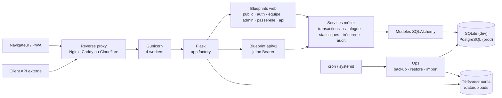

# Architecture — Plateforme Foy'z & Bar

Vue d'ensemble des composants, des flux et des règles structurantes de la
plateforme. Ce document reste volontairement au niveau global : l'installation,
le déploiement et l'exploitation sont décrits dans le [README](../README.md),
l'API externe dans [API.md](API.md) et la politique de confidentialité dans
[CONFIDENTIALITE.md](CONFIDENTIALITE.md).

## Vue d'ensemble

Le navigateur et les clients de l'API passent par le même reverse proxy.
Gunicorn sert l'application Flask, organisée en blueprints (routes HTTP) et
services (logique métier). SQLAlchemy est l'unique accès à la base. Les
téléversements et les sauvegardes sont sur des volumes ou répertoires séparés.

## Composants

### Application Flask

- `wsgi.py` est le point d'entrée de production ; `run.py` lance le serveur de
  développement.
- `app/__init__.py` crée l'application, charge la configuration, enregistre les
  blueprints, applique le contrôle CSRF et les en-têtes de sécurité.
- `app/config.py` lit les variables d'environnement ; `app/campus.py` définit
  les campus connus et actifs ; `app/extensions.py` instancie SQLAlchemy.
- `app/schema.py` applique le schéma : `create_all()` en SQLite de
  développement, révisions Alembic en PostgreSQL de production.
- `app/logging_setup.py` produit des journaux JSON ; `app/gunicorn_logging.py`
  masque les jetons de passerelle dans le journal d'accès.

### Blueprints

| Blueprint | Préfixe | Rôle |
|---|---|---|
| `public` | `/` | Accueil, catalogue, règlement, liens utiles |
| `auth` | — | Connexion et déconnexion |
| `team` | `/equipe` | Caisse, comptes étudiants, historique, statistiques, trésorerie, notes |
| `admin` | `/admin` | Comptes, équipe, articles, fûts et tireuses, événements, journal, santé, jetons API, module développement |
| `gateway` | `/passerelle/<token>` | Encaissement d'un événement sans compte, via un lien à jeton |
| `api` | `/api` | Endpoints JSON internes à la caisse et à la passerelle |
| `api_v1` | `/api/v1` | API externe : catalogue, consommations, prix ; jeton Bearer |

### Services métier

Les routes restent minces ; les règles métier sont dans `app/services/` :

- `transactions.py` : ventes, rechargements, retraits, transferts, retours de
  consignes et annulations ; verrouillage des portefeuilles et idempotence.
- `catalog.py` : articles, fûts, tireuses et prix.
- `stats.py`, `treasury.py`, `event_recap.py` : agrégats, exports CSV et
  récapitulatifs d'événements.
- `audit.py`, `adminpw.py`, `passwords.py`, `loginthrottle.py`,
  `api_tokens.py` : journal d'audit, mot de passe administrateur, politique de
  mot de passe, limitation des connexions et jetons d'API.
- `health.py` : sonde `/health` et tableau de bord de santé.
- `settings.py` : réglages modifiables depuis l'administration.

## Données

Les modèles SQLAlchemy sont dans `app/models/` :

| Domaine | Modèles |
|---|---|
| Comptes | `User`, `Wallet` |
| Catalogue | `Article`, `Keg`, `KegPrice`, `Tap` |
| Ventes | `Transaction`, `TransactionLine`, `Contribution` |
| Événements | `Event` |
| Système | `Setting`, `AuditLog`, `LoginLog`, `LoginThrottle`, `UsefulLink`, `Note` |
| API externe | `ApiToken`, `ApiTokenArticle`, `ApiTokenKeg` |

- Les montants sont stockés en **centimes**.
- Chaque portefeuille est rattaché à un utilisateur et à un campus.
- SQLite sert au développement, aux tests et aux petites installations ;
  PostgreSQL 16 est la cible de production.
- Les révisions de schéma sont dans `migrations/versions/` ; une base SQLite de
  développement est créée par `create_all()`.
- Les téléversements vont dans `UPLOAD_DIR` (`/data/uploads` avec Docker),
  limités à 20 Mo par requête.
- Les sauvegardes sont produites par `ops/backup.py` (base + téléversements,
  rétention 7 quotidiennes / 4 hebdomadaires, hors-site optionnel) et restaurées
  par `ops/restore.py`.

## Déploiement

| Mode | Composants | Remarque |
|---|---|---|
| Docker Compose | conteneur `web` + PostgreSQL 16, volumes `pgdata` et `uploads` | mode recommandé |
| systemd | Gunicorn + Nginx + PostgreSQL local | alternative sans Docker |
| Cloudflare | proxy/TLS devant Nginx ou Caddy | option publique, `TRUSTED_PROXY=cloudflare` |

- Gunicorn tourne avec 4 workers et recycle les workers (`--max-requests`) ;
  l'image Docker s'exécute avec un utilisateur non-root.
- Au démarrage Docker, `flask --app wsgi.py init-db` applique le schéma, puis
  Gunicorn démarre. En PostgreSQL, `init-db` et `upgrade-db` appliquent les
  révisions Alembic en attente.
- `/health` sert de sonde et la page `/admin/sante` reprend les mêmes contrôles.
- Les journaux partent sur stdout/stderr, collectés par Docker ou systemd.

## Règles structurantes

- **Campus** : `FOYZ_ACTIVE_CAMPUSES` définit les campus exposés et modifiables.
  Un campus inactif est archivé, pas supprimé : ses données restent en base et
  restent libellables, mais aucune interface ne les expose. En production,
  Brest est actif et Paris est archivé.
- **Argent** : les montants sont en centimes, les portefeuilles sont verrouillés
  pendant les écritures, et les opérations d'argent utilisent une clé
  d'idempotence pour éviter les doubles débits.
- **Authentification** : session et jeton CSRF pour l'interface web ; jeton
  porteur pour `api/v1` ; lien à jeton et limitation par IP pour la passerelle.
  Les connexions sont limitées par identifiant et par IP.
- **Traçabilité** : les actions d'administration sensibles sont écrites dans le
  journal d'audit ; les connexions ont leur propre journal ; les journaux
  applicatifs sont en JSON et les jetons de passerelle sont masqués dans le
  journal d'accès.
- **Caisse en ligne** : aucune vente n'est stockée ni rejouée hors ligne ; la
  PWA est installable mais l'encaissement exige le réseau.
- **Sauvegardes** : l'application ne déclenche pas les sauvegardes ; elle lit
  leur état pour la page santé. La production passe par `ops/backup.py`.

## Où lire le code

| Chemin | Contenu |
|---|---|
| `wsgi.py`, `run.py` | Points d'entrée production et développement |
| `app/__init__.py` | Fabrique Flask, blueprints, CSRF, gestion des erreurs |
| `app/routes/` | Routes HTTP par espace |
| `app/services/` | Logique métier |
| `app/models/` | Modèles SQLAlchemy |
| `migrations/` | Révisions Alembic |
| `ops/` | Sauvegarde, restauration, import |
| `tests/` | Suites de tests |
| `migration/` | ETL ponctuel des anciennes bases, hors runtime |

Dernière mise à jour : 9 novembre 2026.
